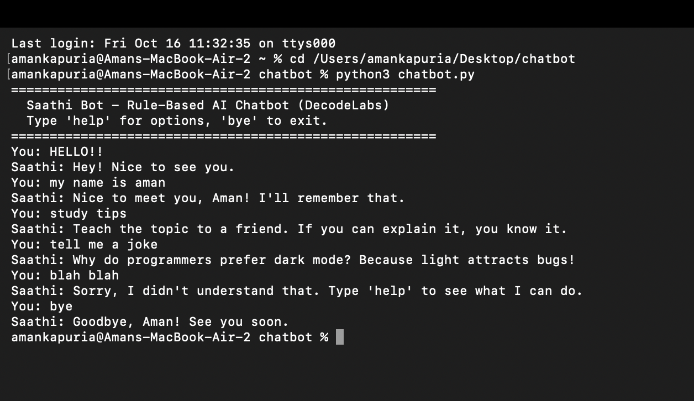

# Saathi Bot – Rule-Based AI Chatbot 🤖

**DecodeLabs AI Internship | Project 1**

Saathi is a simple chatbot that runs in the terminal. It replies to what you type using fixed rules that I wrote myself. There is no machine learning here: it is pure logic, built with Python loops, if-else checks and dictionaries.

## Features

- **Continuous loop:** keeps chatting until you type `bye`, `exit`, `quit` or `goodbye`
- **Input cleaning:** `HELLO!!`, `  hello ` and `Hello` are all treated the same (lowercase, extra spaces and punctuation removed)
- **Knowledge base:** a dictionary with **10 intents**: greeting, how are you, bot name, help, thanks, study tips, motivation, joke, time and date
- **Many ways to say one thing:** `hi`, `hey`, `hello` and `good morning` all count as a greeting
- **Fallback reply:** unknown messages get a friendly "Sorry, I didn't understand" reply
- **Remembers your name:** say `my name is ...` and Saathi uses it later in the chat
- **Random replies:** each intent has a few replies, so the bot feels less robotic

## How it works (IPO model)

```
INPUT   ->  read what the user types and clean it
PROCESS ->  look up the intent in a dictionary (no long if-elif ladder)
OUTPUT  ->  print the reply, or a fallback reply
```

Using a dictionary instead of a long if-elif chain makes each lookup fast (O(1)) and keeps the code easy to grow: adding a new reply means adding one line to the dictionary.

## How to run

You need Python 3 installed.

```bash
python chatbot.py
```

## Sample chat



```
You: HELLO!!
Saathi: Hey! Nice to see you.
You: my name is aman
Saathi: Nice to meet you, Aman! I'll remember that.
You: study tips
Saathi: Teach the topic to a friend. If you can explain it, you know it.
You: blah blah
Saathi: Sorry, I didn't understand that. Type 'help' to see what I can do.
You: bye
Saathi: Goodbye, Aman! See you soon.
```

## Project checklist

- [x] Input loop with `while True`
- [x] Sanitization (case and whitespace)
- [x] Knowledge base dictionary with 5+ intents
- [x] Fallback response for unknown input
- [x] Clean exit command with `break`

## Author

**Aman Kapuria**: [LinkedIn](https://www.linkedin.com/in/aman-kapuria-264bb1376/) · [GitHub](https://github.com/aman17102005)
